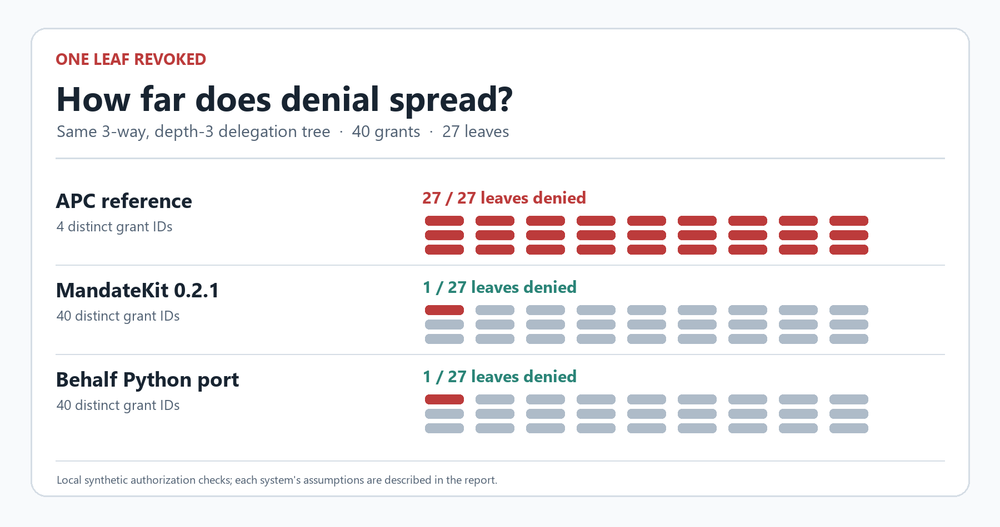

# APC conformance reproduction

This local research artifact reproduces specific conformance probes against a
pinned APC reference implementation, plus narrow positive controls from two
independent delegation libraries. It contains the original audit scripts and
sanitized reference results. It is not a production security assessment.

## Run

Requirements: Python 3.11+ and Git. No pip installation, model account, paid API,
SSH target, or live transaction is needed.

```sh
python reproduce.py
```

The first run fetches the three public Git repositories at the exact commits
below into `alternatives/`. Experiment execution is local. The program refuses
wrong commits or dirty checkouts and does not overwrite an existing checkout.
Rerun with `python reproduce.py --offline` after checkout preparation.
Behalf's official test suite includes local loopback HTTP test servers; it does
not require an external service.

For an already available local cache, use
`python reproduce.py --offline --upstream-cache /path/to/alternatives`.
The cache must contain the three named Git checkouts. Source code is copied to
new local checkouts; cached repositories are not modified.

Results are written to `results/apc/`; `results/reproduction_summary.json` records
the command outcomes and validates the expected qualitative observations.
The shipped snapshots are under `reference_results/apc/` and are not overwritten.
IDs, timestamps, platform descriptions, and timings can differ across runs.
Pure-Python signature verification in the graph campaign can take several
minutes; the reproducer allows up to 15 minutes for that step.

`submission/project-image.png` visualizes the recorded matched-tree result.
Its original generator, `submission/make_project_image.py`, is included as an
optional convenience. Regenerating that PNG requires Pillow and the Windows
Segoe UI fonts; neither is needed by `reproduce.py`.



## Pinned upstreams

| Directory | Repository | Commit | Upstream license |
| --- | --- | --- | --- |
| `bounded_agents` | https://github.com/xmuruaga/bounded-agents | `d31a1ea115a3e97ab972ac8d03f23ef36cf9b653` | Apache-2.0 |
| `mandatekit` | https://github.com/major-matters/mandatekit | `fc6a3745ef3eab5ee1e8842f275a5666cf9ffc4f` | MIT |
| `behalf_agent_authority` | https://github.com/novaai0401-ui/agent-authority | `556f91cc7f356a74d625d798321ad998288f1ab0` | MIT |

Upstream code is not vendored in this ZIP. Each fetched checkout retains its
own license. `manifest.json` records pins, source-copy hashes, and shipped-file
hashes. The scripts in `src/` are byte-identical copies of the local audit source.
All fixed signing material in those fixtures is invented public test data,
used only for local synthetic grants. No operational credential is included.

## Expected observations

* APC's depth-3 / signed-cap-2 action is admitted after removing the unrelated
  irreversible-effects preload from the named upstream negative scenario.
* The original k-tuple comparison is already blocked by a pairwise rule. An
  isolated comparison also demonstrates that the k-tuple mechanism works when
  tested without that confound.
* In the 3-ary, depth-3 APC tree, 40 grants have 4 distinct envelope IDs. Revoking
  one leaf's ID denies all 27 leaf requests, including 26 off-target leaves.
* The illustrative persistence fault admits two 0.6-cost actions against a 1.0
  cap when the first backend save returns false and the next state is reloaded.
* MandateKit's unchanged verifier distinguishes legal and over-depth chains.
  Its matching 40-grant tree has 40 IDs and one denial after one leaf revocation.
* Behalf's unchanged API also has 40 IDs and one denial in the matched tree;
  an independent root remains allowed. Three official core revocation tests pass.

## Limits and prior work

These are deterministic local probes of the pinned versions, not measurements
of agent populations, attack prevalence, model behavior, exploitation in a
deployment, cryptographic soundness, or all possible authorization workflows.
The 40-grant topology is a test shape, not an inferred real swarm.

The comparisons cover particular declared controls, not overall framework
rankings. Behalf does not provide the maximum-depth comparator. Revocation uses
one local, current state domain; distributed freshness is not tested. MandateKit
is an unaudited prototype and can use its pure-Python crypto fallback. The optional
issuer repair is an illustrative fixture, not a reviewed production patch.
Persistence and runtime-state binding probes make explicit adapter assumptions;
they do not invalidate the APC algebra under its stated premises.

The shipped Behalf full-suite record is **114 tests with one CLI
quickstart/lint failure and six optional-crypto skips** in the recorded environment.
Its three passing core tests and matched fixture are recorded separately. The
reproducer retains the full-suite outcome instead of claiming every test passes.
That CLI outcome may differ on another platform.

Expected-cause conformance checks and paired controls are prior art, including
APC issue #1 and PR #4. This artifact examines particular within-condition
mechanisms and reference-integration paths; it does not claim those testing
principles are new.

* APC paper: https://arxiv.org/abs/2608.15888
* Prior conformance discussion: https://github.com/xmuruaga/bounded-agents/issues/1
* Prior conformance PR: https://github.com/xmuruaga/bounded-agents/pull/4
* APS conformance suite: https://github.com/Agent-Authority-Conformance/aps-conformance-suite

Stored result locations and executable paths are normalized. No upstream clones,
personal filesystem paths, real credentials, or earlier unrelated datasets are
included. The reproducer makes no external writes.

## Matched graph campaign

`src/graph_contract_campaign.py` adds five small graph shapes and three label
settings, with 45 native cases across the three SDKs. The APC target-only
revocation verdict and reason pass in all 15 native cases while grant-population
contracts fail; the two independent native controls pass their 15 cases each.
The 45 additional records are three hand-selected artificial Behalf issuance or
revocation faults, not discovered upstream vulnerabilities. The population
checks cover more inputs; their sensitivity is not an equal-cost superiority
claim or a novel testing principle. Display renaming is model metadata only,
not a native SDK rename operation. Source hashes remain unchanged and socket
connections are blocked in the campaign.

## Upstream DevOps fixture

`src/apc_case_study_check.py` imports APC's unmodified Section 7 DevOps case
study. Its validly signed planner, reviewer and deployer grants share one ID.
Three scope-permitted, low-impact probes with other budgets and approval
nonblocking allow before one planner-ID revocation and deny afterward. The
case study's high-impact deploy path is not replayed. This is a local test
fixture, not a deployed DevOps system.

## Illustrative repair

`patches/apc_depth_identity_fix.patch` adds issuance/admission depth checks and
UUIDv4 child grant IDs. It is a bounded demonstration, not a reviewed production
patch. Child-ID uniqueness is probabilistic, root IDs remain caller supplied,
and old colliding grants are not migrated. Exact-ID revocation remains; ancestor
cascading is not added.

The default reproducer applies the exact patch with `git apply --check` in a
new disposable local clone, verifies 12 fixture/apply checks, and leaves the
baseline unchanged. This step runs with `--skip-upstream-tests` so no pytest
installation is needed. The saved reference validation has 13 checks, including
one check for 47 passing original tests in `tests/test_core.py`,
`tests/test_budget.py` and `tests/test_pdp.py`. To repeat those original tests
when `pytest==8.4.2` (the tested version) is already available, run:

```sh
python -B src/apc_patch_validation.py
```

The legacy adaptive depth-overflow scenario now raises at issuance; its expected
output would need updating against this patch. Other budgets, composition,
persistence, cryptographic assurance and distributed revocation are outside
this illustrative repair.
